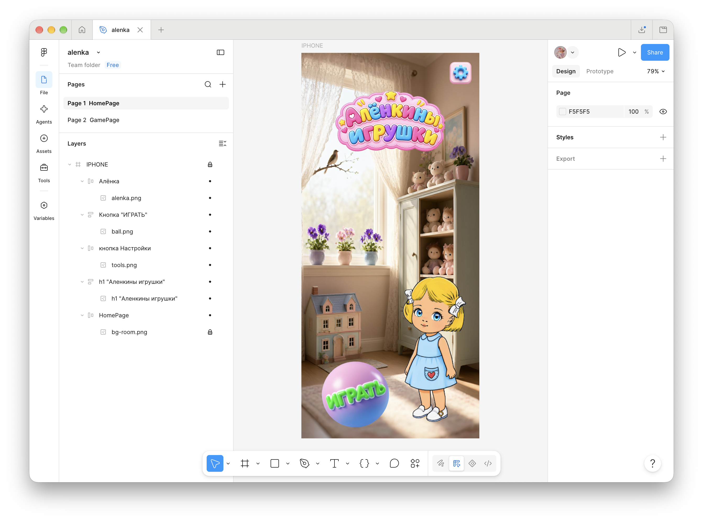
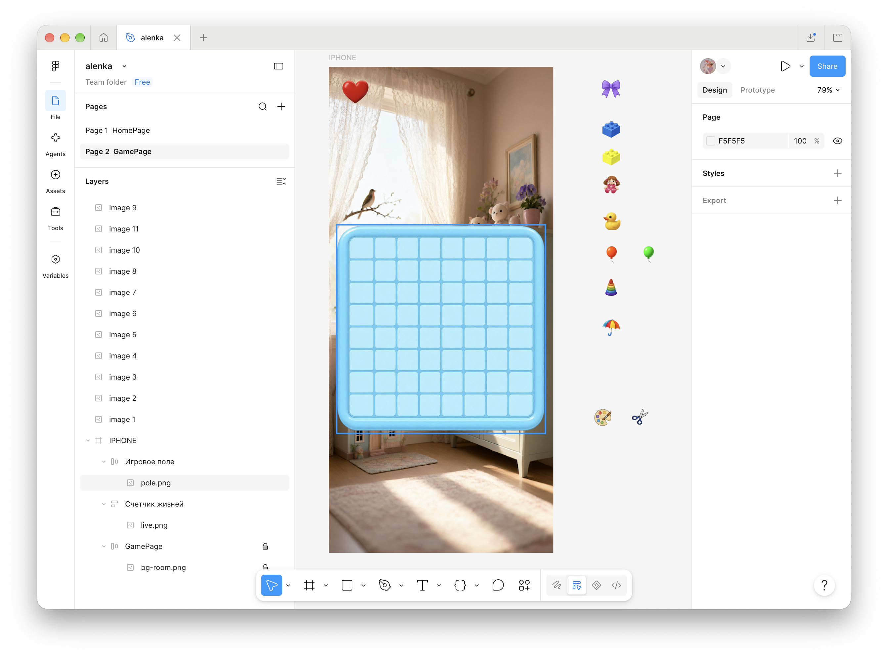
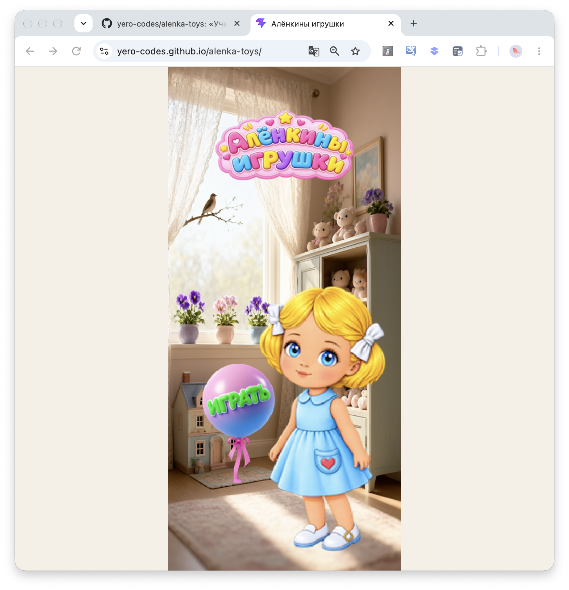
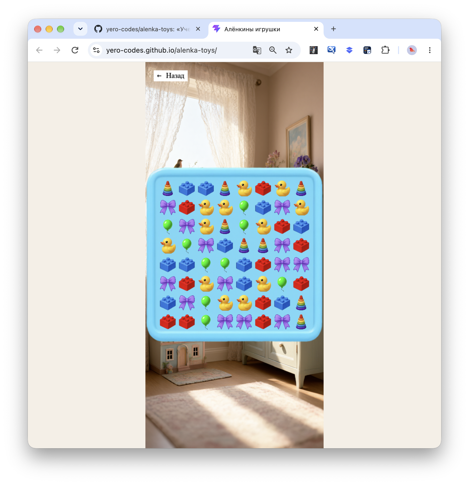
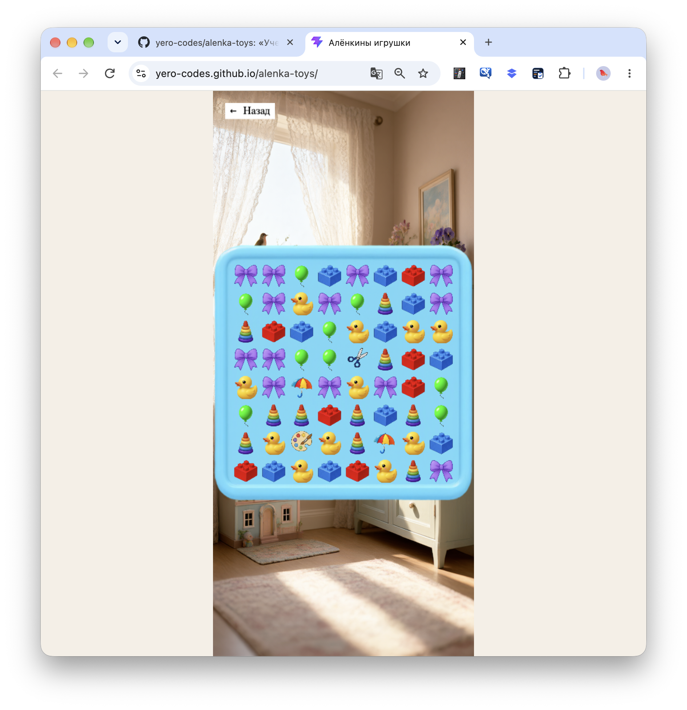

# Алёнкины игрушки (Match-3)

Учебный проект — казуальная игра в жанре Match-3 (три в ряд), разработанная с нуля. 
Главная особенность: весь визуальный стиль (персонаж, фишки, фоны) нарисован автором вручную, а затем оцифрован и обработан с помощью нейросетей.

**Проект разрабатывается специально для мобильных устройств (портретный режим, формат iPhone).**

## 🎯 Задача проекта
Создать полноценный игровой прототип с уникальной механикой и авторским дизайном, чтобы в дальнейшем превратить его в коммерческий продукт (с монетизацией и публикацией на игровых площадках).

## 🎨 Дизайн и графика
Весь визуал был создан с нуля:
1.  **Наброски:** Рисунки персонажей и игрушек на бумаге маркерами.
2.  **Оцифровка:** Обработка рисунков в нейросетях (Kokon) для придания им яркости, объема и игрового стиля.
3.  **Макет:** Сборка игровых экранов и слоев в Figma под мобильный экран (430x932).
4.  **Ассеты:** Экспорт всех элементов (фишки, фоны, кнопки) в виде PNG с прозрачностью.

## 🖌️ Работа в Figma
Проект спроектирован с нуля. Все элементы разложены по слоям, фреймам и сгруппированы для удобной работы.

*(Скриншоты из Figma, демонстрирующие структуру проекта)*

### Главный экран (HomePage)

### Игровое поле и слои (GamePage)

## 🎮 Реализованная механика (на данный момент)
- **Сетка 8x8:** Стандартное игровое поле.
- **Свайп (Swipe):** Обмен фишками по свайпу (мышкой или пальцем).
- **Match-3:** Поиск и удаление 3-х фишек в ряд (горизонтально и вертикально).
- **Гравитация и рефилл:** Фишки падают вниз, на месте пустот появляются новые.
- **Каскады:** Автоматическое удаление новых совпадений после падения фишек.
- **Проверка на совпадения:** Фишки не меняются местами, если обмен не создает линию из 3-х.
- **Уникальные бонусы:** 
  - **Ножницы** (4 в ряд по горизонтали) — уничтожают ряд.
  - **Зонтик** (4 в ряд по вертикали) — уничтожают столбец.
  - **Палитра** (5 в ряд) — уничтожает квадрат 3x3 вокруг себя.

## 🛠 Стек технологий
- **React** (оболочка, UI).
- **Phaser.js** (игровой движок).
- **Vite** (сборщик).
- **Figma** (дизайн и макеты).
- **Kokon** (нейросеть для обработки графики).
- **GitHub Pages** (хостинг).

## 🚀 Как играть (живой сайт)
Игра доступна по ссылке: **[Алёнкины игрушки](https://yero-codes.github.io/alenka-toys/)**

*(Совет: откройте ссылку на телефоне и добавьте на главный экран, как приложение).*

## 📸 Скриншоты

### Главный экран

### Игровое поле

### Бонусы (Ножницы, Зонтик, Палитра)
